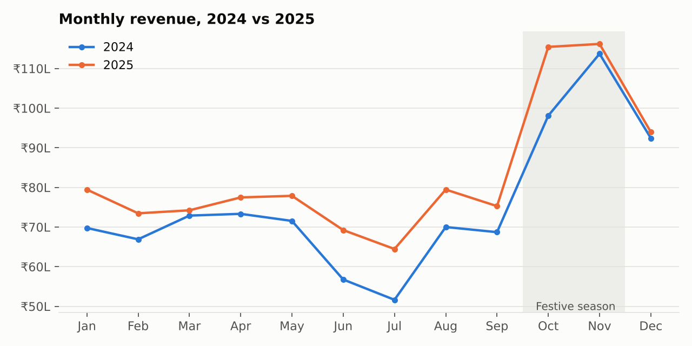
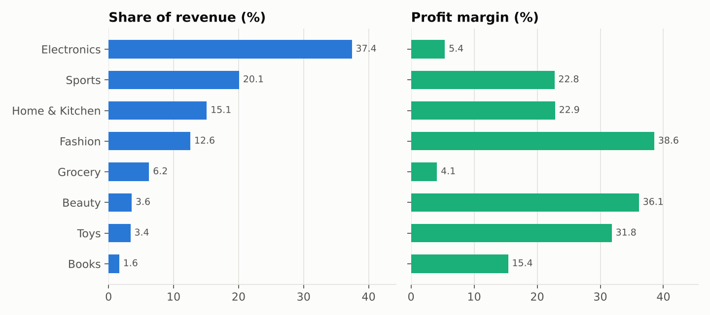
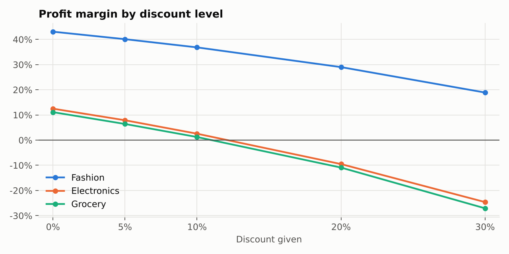
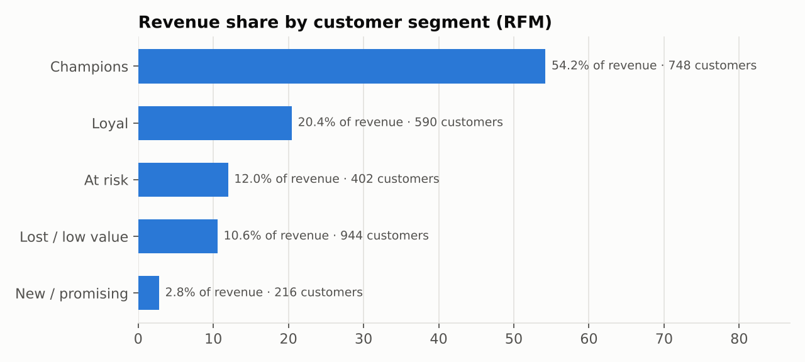
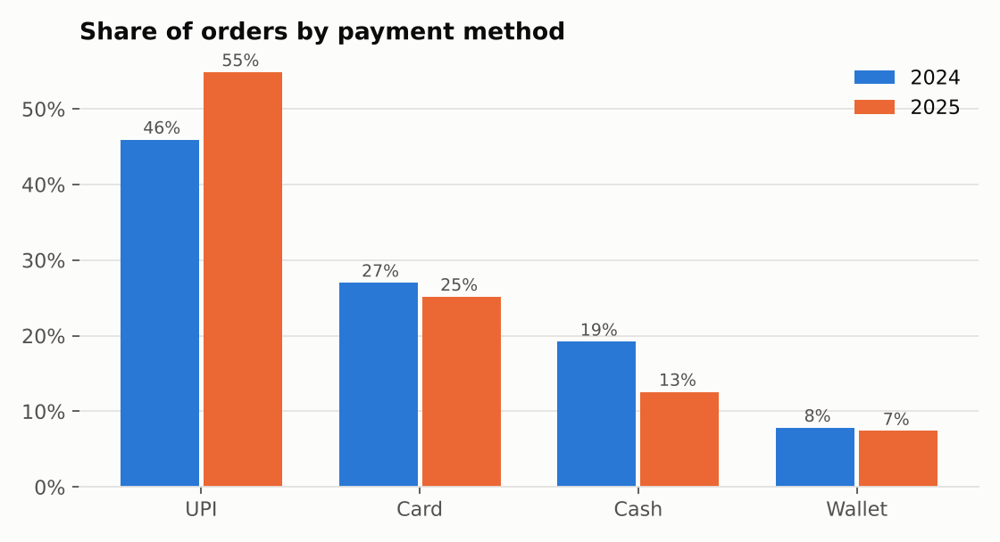
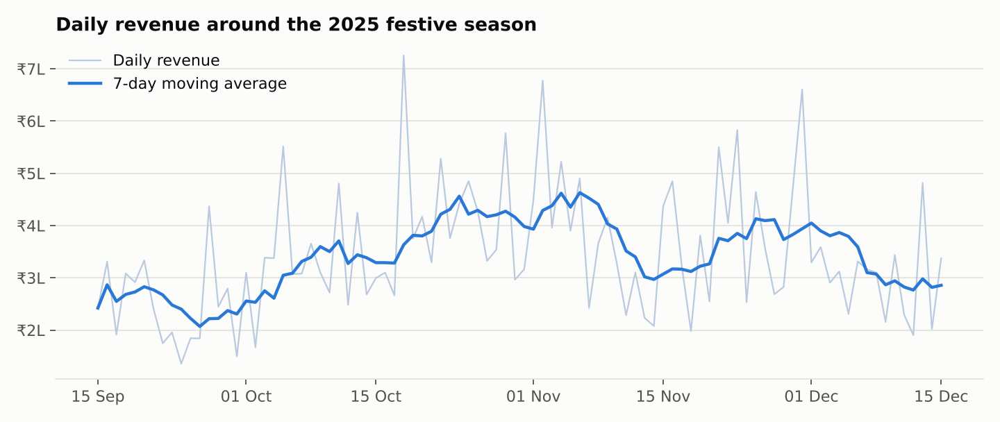
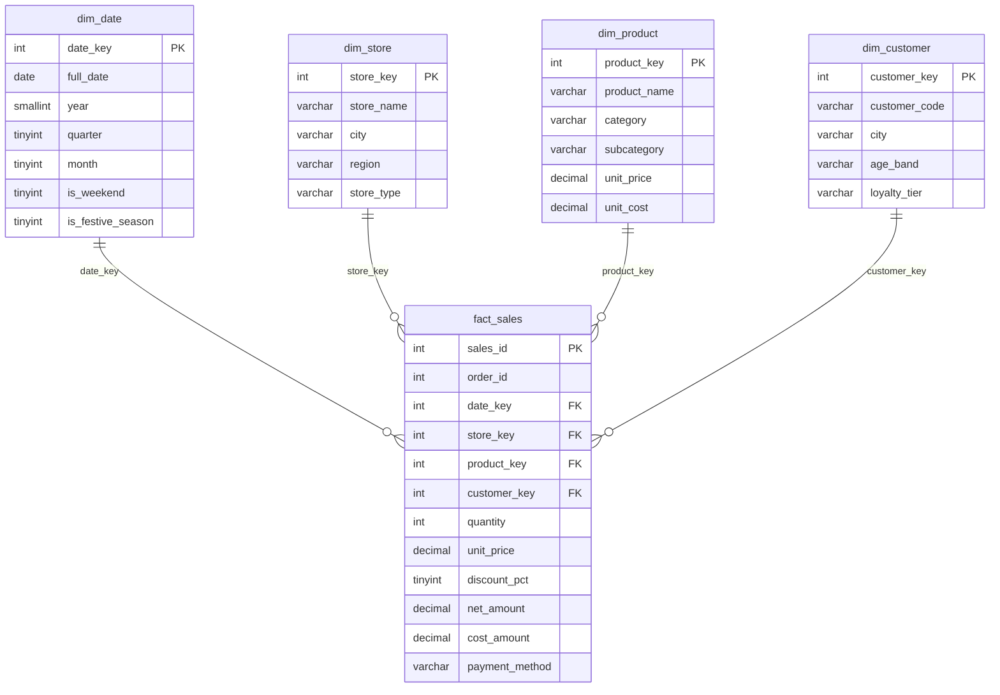

# Retail Sales SQL Analysis

A MySQL analytics project for a fictional Indian retail chain with 12 stores. I designed a star-schema
database, loaded two years of sales (2024–2025), and answered 20 business questions in SQL using
joins, CTEs, window functions and views. Python is only used to generate the sample data and draw the charts.



## Key findings

| # | Finding | Query |
|---|---|---|
| 1 | **₹19.02 crore revenue** from **20,707 orders** at a **17.8% margin**; average order value **₹9,187**. | [Q01](queries/01_business_kpis.sql) |
| 2 | Revenue grew **10.0%** from 2024 to 2025, with the biggest jumps in the weak monsoon months (June +22%, July +25%). | [Q03](queries/03_year_over_year_by_month.sql) |
| 3 | The **October–November festive season** brings **52% more revenue per day**, but heavier discounts cut the margin from **18.9% to 13.9%**. | [Q11](queries/11_festive_season_uplift.sql) |
| 4 | **Electronics** is the largest category (**37.4%** of revenue) but earns only a **5.4%** margin. **Fashion** brings 12.6% of revenue at a **38.6%** margin. | [Q06](queries/06_category_revenue_share.sql) |
| 5 | Discounts of **20% or more lose money** on Electronics (−9.5% margin) and Grocery (−10.9%), while Fashion stays profitable (29%). | [Q17](queries/17_discount_impact_on_margin.sql) |
| 6 | **Champions** — 26% of customers — generate **54.2%** of revenue (RFM segmentation). | [Q14](queries/14_rfm_segments.sql) |
| 7 | **UPI** rose from **45.9% to 54.9%** of orders while cash fell from 19.2% to 12.6%. | [Q16](queries/16_payment_method_mix.sql) |
| 8 | **Mall** stores average **2.7×** the revenue of Express stores; weekends see **33% more orders per day** at a similar order value. | [Q07](queries/07_store_ranking.sql), [Q10](queries/10_weekend_vs_weekday.sql) |
| 9 | **Fashion + Grocery** is the most common category pair in one basket (921 orders). | [Q19](queries/19_category_pairs_in_basket.sql) |

<table>
<tr>
<td></td>
<td></td>
</tr>
<tr>
<td></td>
<td></td>
</tr>
</table>



> The data is **synthetic**, generated by [`data/generate_data.py`](data/generate_data.py) with realistic
> patterns built in (festive peaks, weekend traffic, repeat shoppers, discount effects). The numbers
> above are what the SQL found in that dataset (seed 42).

## Data model

A star schema: one fact table at order-line level, surrounded by four dimensions.



| Table | Rows | Description |
|---|---:|---|
| `fact_sales` | 38,772 | One row per product in an order |
| `dim_date` | 731 | Every day of 2024–2025, with weekend and festive-season flags |
| `dim_customer` | 3,000 | City, age band, loyalty tier |
| `dim_product` | 132 | 8 categories, 32 subcategories, price and cost |
| `dim_store` | 12 | Malls, high-street and express stores in 4 regions |

## The 20 business questions

| # | Question | SQL techniques |
|---|---|---|
| [01](queries/01_business_kpis.sql) | Headline KPIs for the whole period | Aggregates, `COUNT(DISTINCT)` |
| [02](queries/02_monthly_revenue_mom_growth.sql) | Month-on-month revenue growth | `LAG()` window function |
| [03](queries/03_year_over_year_by_month.sql) | 2025 vs 2024 by month | Conditional aggregation (`CASE`) |
| [04](queries/04_top_10_products.sql) | Top 10 products by revenue | `RANK()` |
| [05](queries/05_top_3_products_per_category.sql) | Top 3 products in each category | CTE + `ROW_NUMBER() OVER (PARTITION BY)` |
| [06](queries/06_category_revenue_share.sql) | Revenue share and margin by category | `SUM() OVER ()` for percent of total |
| [07](queries/07_store_ranking.sql) | Store ranking, overall and within region | Two `RANK()` windows, view |
| [08](queries/08_region_by_quarter.sql) | Region × quarter revenue | Pivot with `CASE` |
| [09](queries/09_running_total_by_year.sql) | Cumulative revenue through each year | Running total with a window frame |
| [10](queries/10_weekend_vs_weekday.sql) | Weekend vs weekday orders | `CASE` grouping, order-level view |
| [11](queries/11_festive_season_uplift.sql) | Festive-season uplift | Grouped comparison |
| [12](queries/12_repeat_customer_rate.sql) | Repeat customer rate | CTE |
| [13](queries/13_customer_cohort_retention.sql) | Quarterly cohort retention | Multiple CTEs, `CROSS JOIN`, NULL handling |
| [14](queries/14_rfm_segments.sql) | RFM customer segmentation | `NTILE(5)`, `CASE` segments |
| [15](queries/15_top_customers_lifetime_value.sql) | Top customers by lifetime value | Multi-table joins |
| [16](queries/16_payment_method_mix.sql) | Payment mix by year | `PARTITION BY` share |
| [17](queries/17_discount_impact_on_margin.sql) | Margin at each discount level | Grouping on two dimensions |
| [18](queries/18_unsold_and_slow_products.sql) | Unsold and slow-moving products | `LEFT JOIN`, `COALESCE`, `HAVING` |
| [19](queries/19_category_pairs_in_basket.sql) | Categories bought together | Self-join on `order_id` |
| [20](queries/20_daily_revenue_7day_moving_avg.sql) | 7-day moving average of daily revenue | `ROWS BETWEEN 6 PRECEDING AND CURRENT ROW` |

Saved outputs for every query are in [`results/`](results/).

## Performance

[`sql/04_indexes.sql`](sql/04_indexes.sql) adds indexes on `order_id`, `(customer_key, date_key)`,
`(date_key, store_key)` and `dim_product(category)`. [`scripts/benchmark_indexes.sh`](scripts/benchmark_indexes.sh)
times the heaviest queries with and without them (median of 5 runs) and writes a table to the
GitHub Actions job summary on every push.

## Run it yourself

Requirements: MySQL 8, Python 3.9+.

```bash
# 1. Generate the dataset (standard library only)
python data/generate_data.py

# 2. Allow CSV loading (once, as root)
mysql -u root -p -e "SET GLOBAL local_infile = 1;"

# 3. Create the schema, load the data, build views and indexes, run all queries
MYSQL_USER=root MYSQL_PASSWORD=yourpassword ./scripts/run_all.sh

# 4. Optional: benchmark the indexes
MYSQL_USER=root MYSQL_PASSWORD=yourpassword ./scripts/benchmark_indexes.sh

# 5. Optional: redraw the charts from results/
pip install -r requirements.txt
python scripts/make_charts.py
```

Every push runs the whole pipeline on a fresh MySQL 8.0 server in
[GitHub Actions](.github/workflows/sql-ci.yml) and checks that all 20 queries return data.

## Project structure

```
├── data/generate_data.py        # synthetic dataset generator (CSV files are git-ignored)
├── sql/
│   ├── 01_schema.sql            # star schema with keys and CHECK constraints
│   ├── 02_load.sql              # LOAD DATA for each CSV
│   ├── 03_views.sql             # monthly revenue, orders, store scorecard, RFM inputs
│   └── 04_indexes.sql           # indexes for the analysis workload
├── queries/                     # 20 business questions, one file each
├── results/                     # output of each query
├── scripts/
│   ├── run_all.sh               # build + load + run everything
│   ├── benchmark_indexes.sh     # before/after index timings
│   └── make_charts.py           # charts for this README
├── docs/charts/                 # generated charts
└── .github/workflows/sql-ci.yml # CI on MySQL 8.0
```

## Skills demonstrated

Data modelling (star schema, keys, constraints) · SQL joins, aggregation and `CASE` · CTEs ·
window functions (`RANK`, `ROW_NUMBER`, `LAG`, `NTILE`, running totals, moving averages) ·
views · indexing and benchmarking · cohort and RFM analysis · turning query results into
business recommendations · CI for SQL with GitHub Actions.

---
Built by **Pallavi Patil** · [LinkedIn](https://www.linkedin.com/in/pallavi-patil-6baa13253) · [GitHub](https://github.com/pallavipatil1111)
